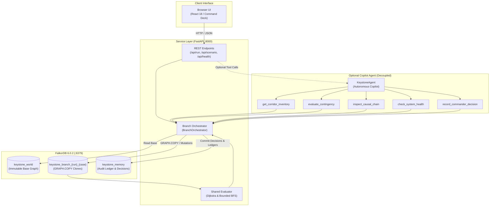
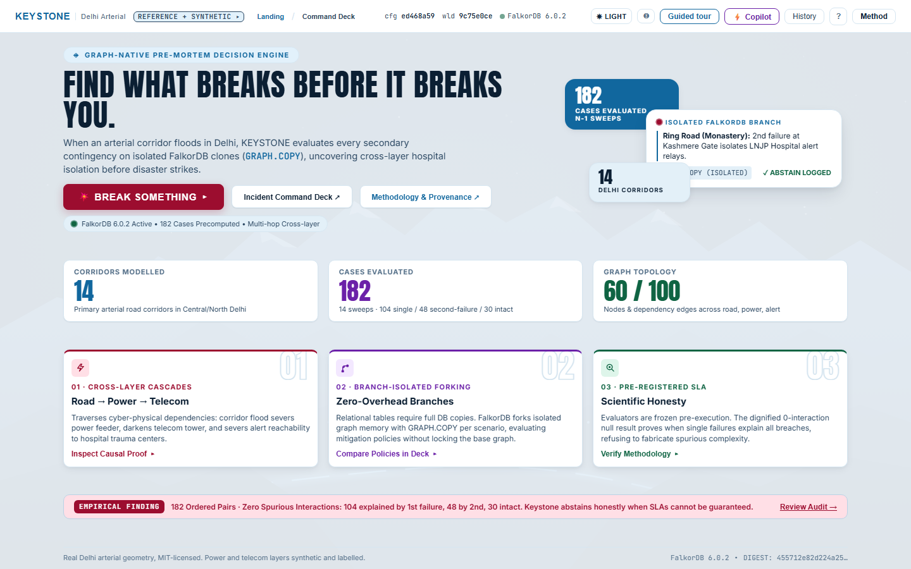
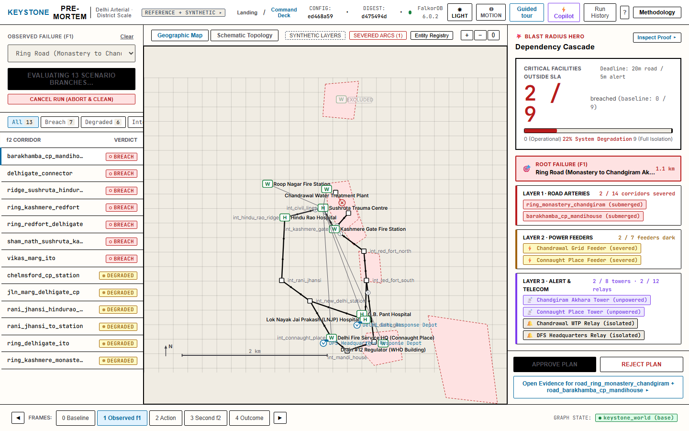
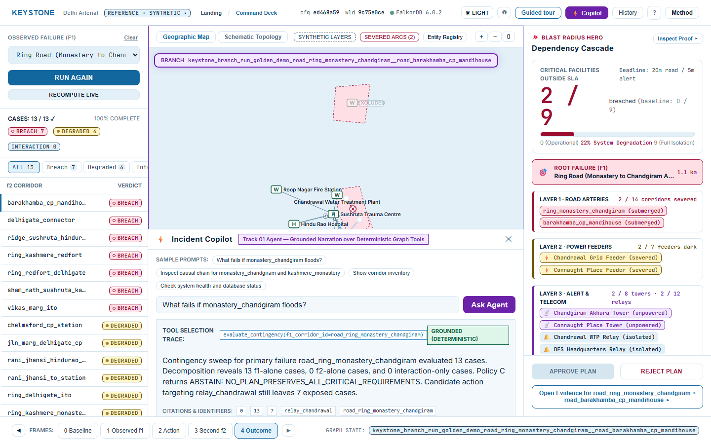
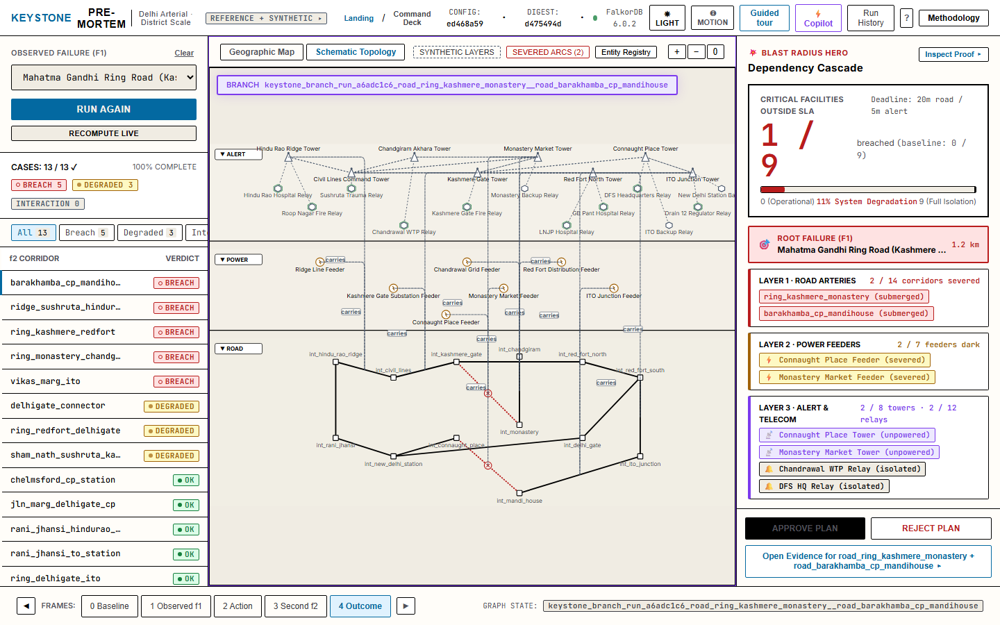
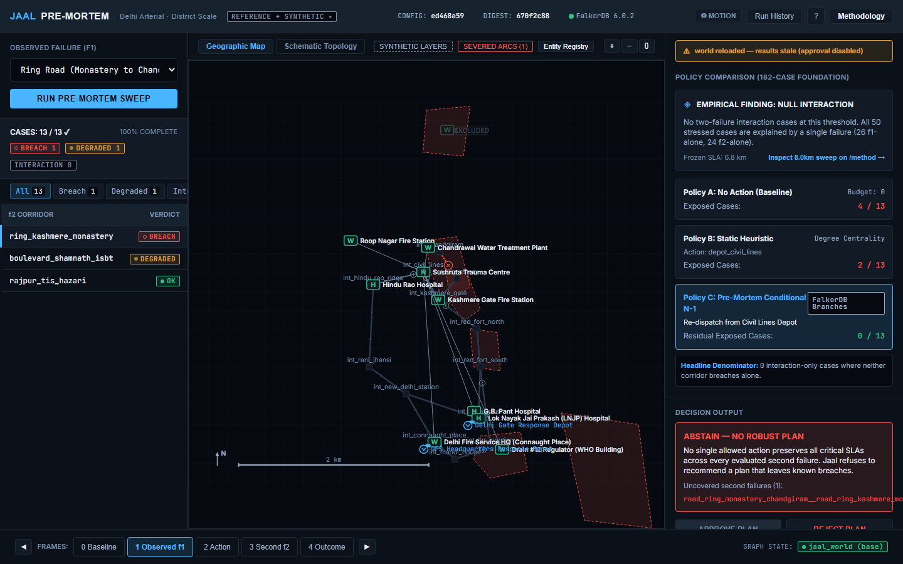
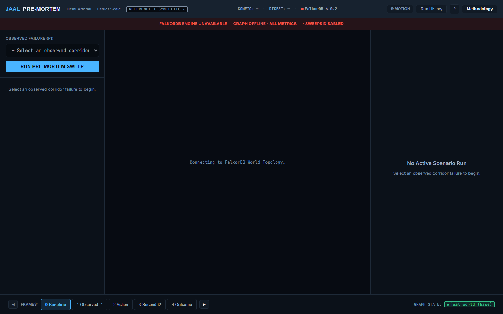
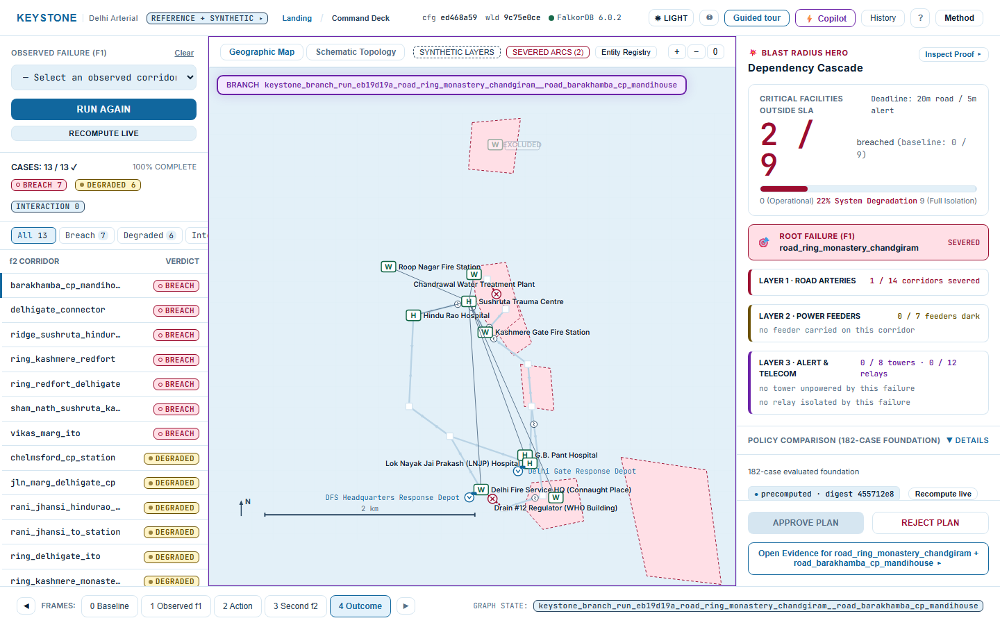
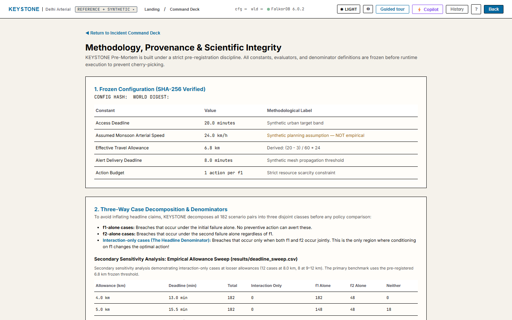
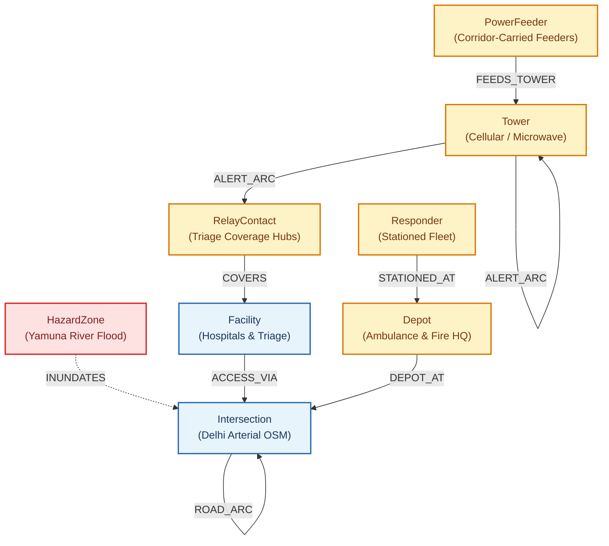

# KEYSTONE Pre-Mortem
**Graph-Native Disaster-Response Pre-Mortem Decision Agent**  
*Track 01 — Solo Entry | WeMakeDevs × FalkorDB Graph Hacks (15–18 October 2026)*

[](https://falkordb.com)
[](https://python.org)
[](https://fastapi.tiangolo.com)
[](https://react.dev)
[](LICENSE)

---

## 1. Executive Summary & The Vertical Slice

> **The Vertical Slice in One Sentence:**  
> When an initial arterial road failure occurs during an urban disaster, KEYSTONE evaluates **every** possible secondary corridor failure on isolated FalkorDB branches, computes multi-hop road access and alert reachability under a single shared evaluator, and delivers an evidence-linked preventive action **or an explicit abstention** that the incident commander approves or rejects — with the approval persisted into the graph.

KEYSTONE is not a predictive weather dashboard, nor does it claim to calculate real-world emergency dispatch probabilities. It is a deterministic, graph-native pre-mortem decision engine. By evaluating **conditional $N-1$ contingencies** on isolated graph clones (`GRAPH.COPY`), KEYSTONE solves the cascading failure problem that static tabular heuristics cannot see.

### Runtime Architecture



> **Architecture Proof:** This diagram proves the decoupled runtime architecture where the primary Command Deck operates deterministically via isolated FalkorDB branches (`GRAPH.COPY`) completely independently of the optional copilot agent (the Command Deck operates with 100% functionality with the agent disabled).

---

## What it looks like

| | |
|---|---|
|  |  |
| **Landing dashboard.** The entry point. Three counters read live from `/api/world/summary` — never hard-coded — over a provenance strip naming the licence of the real data and labelling the synthetic layers. | **Incident Command Deck.** All fourteen corridor sweeps are precomputed and digest-validated, so there is no loading step. Blast radius cascades across road, power and alert layers. |
|  |  |
| **Incident Copilot — Track 01.** A plain-language question resolved to a typed graph tool, with the tool and its arguments shown, a `GROUNDED (DETERMINISTIC)` badge asserting every figure came from a tool result, and the live `keystone_branch_…` clone named in the header. | **Three-band cross-layer view.** Delhi arterial roads, telecom alert relays and power feeders in one synchronised schematic — the vertical connectors are the cross-layer dependency the product traverses. |
|  |  |
| **ABSTAIN with a real reason code.** When no candidate action prevents every SLA breach across every second failure, the deck refuses to recommend one and says why. | **Graceful degradation.** With the database unreachable the deck reports it plainly and emits no numeric fields, rather than rendering stale or invented values. |
|  |  |
| **The honest null finding.** 0 interaction-only cases at the frozen 6.8 km threshold, reported openly on the primary path rather than buried. | **Methodology and provenance.** One page carrying the data sources, the frozen configuration, all three denominators, the threshold sweep, and the limits. |

- **Demo video:** [`web/verification/demo/demo_1440x900.mp4`](web/verification/demo/demo_1440x900.mp4) (03:33) — walks through scenario selection, branch evaluation, cross-layer severance, honest abstention, and commander decision persistence.
- **Guided tour:** Presenter mode is deep-linkable via `?tour=1&step=N` (e.g., `http://localhost:5173/?tour=1&step=1`) to guide judges through the core findings.

---

## 2. The Problem & The Hypothesis

In urban floods (such as the historic July 2023 Yamuna River flood in Delhi), the first infrastructure failure ($f_1$) rarely causes total collapse by itself. Disaster responders react locally. However, when a **second failure ($f_2$)** occurs 30 minutes later, it interacts with $f_1$ to sever critical hospital access corridors or cut microwave backhaul alert relays covering emergency triage units.

**The Hypothesis:**  
Conditioning preventive action on the combinatorial closure of $(f_1, f_2)$ failure pairs on an isolated graph branch identifies high-leverage pre-positioning actions that non-forking heuristics miss, while providing rigorous, verifiable bounds on when an agent must **abstain** because no robust action exists.

---

## 3. Why Graph-Native? (The Three Questions Only a Graph Can Answer)

A flat relational database or key-value store cannot efficiently answer the questions required for pre-mortem disaster response:

1. **"Corridor $X$ is submerged. If one more corridor fails, which critical facilities fall outside the 20-minute access deadline, and by which surviving route?"**  
   *Graph-dependent:* The response time is a shortest-path traversal across dynamic, paired directed road arcs that changes per scenario branch.
2. **"Which next failure would also sever the telecom alert chain to the relay covering that hospital?"**  
   *Graph-dependent:* Road corridor $\to$ `carrier_corridor_id` $\to$ `FEEDS_TOWER` / `ALERT_ARC` $\to$ tower power survival $\to$ bounded directed reachability $\to$ `COVERS` facility. This cross-layer dependency requires traversing 4 relationship types across 2 infrastructure domains.
3. **"Is there one preventive action that preserves all SLAs across all 13 secondary failure candidates — and if not, which cases remain exposed?"**  
   *Graph-dependent:* Requires branching the entire topological world into 13 counterfactual copies in milliseconds, simulating mutations, and evaluating reachability without polluting the base state.

---

## 4. Graph Model & Schema

> **Note on Project & Namespace Alignment:** The product, interface, API, and FalkorDB graph keys are unified under KEYSTONE throughout. The Python backend package lives at `src/jaal/` (retaining its development package namespace so imports read `from jaal.…`), and the local Docker container is `jaal_falkordb`.

KEYSTONE maintains three distinct graph namespaces in FalkorDB:
- `keystone_world`: Pristine infrastructure topology (immutable after ingest, protected by SHA-256 digest guard).
- `keystone_branch_{run}_{case}`: Disposable counterfactual branch copies (created via `GRAPH.COPY`, deleted in `finally:` blocks).
- `keystone_memory`: Append-only audit log storing runs, scenario mutation ledgers, and commander decisions.



> **Schema Proof:** This diagram proves the multi-layer topological graph schema connecting real-world Delhi arterial roads to synthetic power grids, telecom relay networks, and emergency hospital access routes.

### Node Labels
- `Intersection`: 13 arterial junctions derived from Delhi OpenStreetMap data (`id`, `name`, `lon`, `lat`, `data_origin`).
- `Facility`: 10 critical emergency endpoints (`hosp_lnjp`, `hosp_sushruta`, `wtp_wazirabad`, etc.).
- `Depot`: 2 emergency response dispatch bases (`depot_north`, `depot_south`).
- `Responder`: Emergency response units stationed at depots.
- `PowerFeeder`: 7 electrical grid feeders carried along specific road corridors.
- `Tower`: 8 cellular / microwave communication relay towers.
- `RelayContact`: 12 emergency contact hubs covering critical facilities.
- `HazardZone`: 6 riverine flood inundation zones derived from Delhi July 2023 flood contours.

### Relationship Types
- `ROAD_ARC`: Directed road segments connecting intersections with `length_km` and `travel_cost_min`.
- `ACCESS_VIA`: Connects facilities to road intersections with explicit `offset_km`.
- `DEPOT_AT`: Associates dispatch depots with road intersections.
- `STATIONED_AT`: Stations emergency responders at dispatch depots.
- `FEEDS_TOWER`: Electrical feeder powering a telecom tower (`carrier_corridor_id`).
- `ALERT_ARC`: Microwave / mesh communication link with explicit `latency_min` and `carrier_corridor_id`.
- `COVERS`: Associates an alert relay contact hub with a hospital facility.
- `INUNDATES`: Models spatial intersection of flood hazard zones with road corridors during scenario evaluation.

---

## 5. Production Cypher Queries

### Q1 — Road topology fetch, then application-side Dijkstra (what the product actually depends on)

The access metric is computed by Dijkstra **in the service layer, over `ROAD_ARC` rows
read from the evaluated branch graph**. The query the product depends on is this one:

```cypher
MATCH (a:Intersection)-[r:ROAD_ARC]->(b:Intersection)
RETURN a.id, b.id, r.travel_cost_min, r.length_km
```

Per-depot minima are taken in application code, because the documented shortest-path
procedures accept one source and one target and no multi-source form was found.

`algo.SPpaths` **is** available on the pinned image and returns the same weights — it is
used as an independent cross-check in `tests/phase4_evaluator/test_graph_queries.py::test_gr_04_dijkstra_agrees_with_native_sppaths`,
not as the production path:

```cypher
MATCH (a:Intersection {id: $s}), (b:Intersection {id: $t})
CALL algo.SPpaths({sourceNode: a, targetNode: b, relTypes: ['ROAD_ARC'],
                   weightProp: 'travel_cost_min', pathCount: 1})
YIELD pathWeight RETURN pathWeight
```

`algo.AStar` is **absent** on this image (`Unknown function 'algo.AStar'`) and nothing
depends on it. `algo.WCC` is available but is deliberately **not** used as a reachability
proof, because it ignores edge direction.

### Q2 — Cross-Layer Tower Power Dependency
```cypher
MATCH (p:PowerFeeder)-[f:FEEDS_TOWER]->(t:Tower {id: $tid})
WHERE NOT (p.carrier_corridor_id = $corridor_id OR f.carrier_corridor_id = $corridor_id)
RETURN count(f) AS surviving_feeders
```

### Q3 — Bounded Directed Alert Reachability
```cypher
MATCH (s:Tower {is_command_source: true})
MATCH (r:RelayContact {is_required_target: true})
WHERE (s)-[:ALERT_ARC*0..12]->(r)
RETURN DISTINCT r.id
```

---

## 6. Benchmark Methodology & All Three Denominators

### Pre-Registered Configuration (`config/frozen_config.json`)
- **Config SHA-256:** `ed468a59c67aa8a84f23dc7f71caecb0e6e2e5f8fd0cac3491b2070306eeaa35`
- **Access Deadline:** 20.0 minutes
- **Assumed Monsoon Speed:** 24.0 km/h (synthetic assumption)
- **Effective Travel Allowance:** 6.8 km (`(20 - 3) / 60 * 24`)
- **Alert Deadline:** 8.0 minutes (max 12 hops)
- **Action Budget:** Exactly 1 action per $f_1$

### The Three-Way Case Decomposition
All 182 scenario pairs ($14 \times 13$) are decomposed before policy evaluation:

| Outcome | Cases | Fraction |
|---|---|---|
| Stressed by f1 alone | 104 | 57.1% |
| Stressed by f2 alone | 48 | 26.4% |
| Unstressed | 30 | 16.5% |
| Interaction-only | 0 | 0.0% |
| Total evaluated | 182 | 100.0% |

### Secondary Sensitivity Analysis (Allowance Sweep)
The 8.0 km sweep is a **secondary sensitivity analysis** documented on `/method` (yielding 12 interaction cases at 8.0 km and 8 at 9–12 km); it is strictly secondary to the primary pre-registered 6.8 km benchmark.

---

## 7. Primary Policy Results

> **Read this before the numbers.** Two findings here are negative and are reported
> because they are true, not because they help.
>
> **1. Zero interaction-only cases at the frozen threshold.** The threshold was fixed before any result existed; at that threshold the fixture shows no two-failure interaction, so no pre-mortem advantage is demonstrated; interaction cases do appear at 8.0 km (12) and 9-12 km (8); the threshold was deliberately not moved to reach them.
>
> **2. Policy C loses 12 cases to Policy B (Robust vs. Average Trade-Off).** C records 12 losses against B and a higher total breach count across all cases (487 vs 446). This is an explained, structural robust-versus-average trade-off arising directly from C's lexicographic objective:
> - Tier 1: Minimize `exposed_cases_count` (the number of $f_2$ contingencies experiencing any breach).
> - Tier 2: Minimize `total_breaches_sum` across all scenarios.
> For the three primary failures with losses (`road_barakhamba_cp_mandihouse`, `road_ring_monastery_chandgiram`, and `road_vikas_marg_ito`), Policy B's static degree-centrality action (`act_prep_depot_central`) experiences breaches across **all 13** contingencies (exposed count = 13, 0 zero-breach scenarios). In contrast, Policy C's pre-mortem optimization selects a targeted mobile mesh relay action that completely protects 6 contingencies (0 breaches), cutting exposed contingencies from 13 down to 7 (a 46% reduction in failure exposure). However, in the 4 heavy-collapse contingencies (e.g. `road_delhigate_connector`, where baseline breaches = 9), Policy B's depot pre-positioning dampens road delays more than the mesh relay (1 vs 8 breaches). Policy C prioritizes robust contingency coverage over average-case breach dampening, and correctly flags abstention (`abstain = true`) to signal to the commander that no plan exists that preserves all critical SLAs across all contingencies.
>
> Policy C's 103 wins against the no-action baseline show only that acting beats not
> acting — they are not evidence that the pre-mortem conditioning helped.

All policies are evaluated using **one identical shared evaluator** (`SharedEvaluator`):

| Policy | Description | Wins vs A | Ties vs A | Losses vs A | Wins vs B | Ties vs B | Losses vs B | Total Breaches |
|---|---|---|---|---|---|---|---|---|
| **Policy A** | No action (baseline) | — | — | — | — | — | — | 682 |
| **Policy B** | Static degree centrality | 60 | 122 | 0 | — | — | — | 446 |
| **Policy C** | **Pre-Mortem Conditional N-1** | **103** | **79** | **0** | **43** | **127** | **12** | **487** |

### Per-Case Evidence of the 12 Policy C Losses to Policy B

| # | $f_1$ (Primary Failure) | $f_2$ (Second Contingency) | Policy C Action | Policy B Action | Breaches (A) | Breaches (B) | Breaches (C) | Outcome vs B |
|---|---|---|---|---|---|---|---|---|
| 1 | `road_barakhamba_cp_mandihouse` | `road_delhigate_connector` | `act_relay_relay_dfs` (mobile relay) | `act_prep_depot_central` (depot central) | 9 | 1 | 8 | LOSS (8 vs 1) |
| 2 | `road_barakhamba_cp_mandihouse` | `road_ring_kashmere_redfort` | `act_relay_relay_dfs` (mobile relay) | `act_prep_depot_central` (depot central) | 11 | 3 | 10 | LOSS (10 vs 3) |
| 3 | `road_barakhamba_cp_mandihouse` | `road_ring_redfort_delhigate` | `act_relay_relay_dfs` (mobile relay) | `act_prep_depot_central` (depot central) | 9 | 1 | 8 | LOSS (8 vs 1) |
| 4 | `road_barakhamba_cp_mandihouse` | `road_sham_nath_sushruta_kashmere` | `act_relay_relay_dfs` (mobile relay) | `act_prep_depot_central` (depot central) | 9 | 1 | 8 | LOSS (8 vs 1) |
| 5 | `road_ring_monastery_chandgiram` | `road_delhigate_connector` | `act_relay_relay_chandrawal` (mobile relay) | `act_prep_depot_central` (depot central) | 9 | 1 | 8 | LOSS (8 vs 1) |
| 6 | `road_ring_monastery_chandgiram` | `road_ring_kashmere_redfort` | `act_relay_relay_chandrawal` (mobile relay) | `act_prep_depot_central` (depot central) | 11 | 3 | 10 | LOSS (10 vs 3) |
| 7 | `road_ring_monastery_chandgiram` | `road_ring_redfort_delhigate` | `act_relay_relay_chandrawal` (mobile relay) | `act_prep_depot_central` (depot central) | 9 | 1 | 8 | LOSS (8 vs 1) |
| 8 | `road_ring_monastery_chandgiram` | `road_sham_nath_sushruta_kashmere` | `act_relay_relay_chandrawal` (mobile relay) | `act_prep_depot_central` (depot central) | 9 | 1 | 8 | LOSS (8 vs 1) |
| 9 | `road_vikas_marg_ito` | `road_delhigate_connector` | `act_relay_relay_drain12` (mobile relay) | `act_prep_depot_central` (depot central) | 9 | 1 | 8 | LOSS (8 vs 1) |
| 10 | `road_vikas_marg_ito` | `road_ring_kashmere_redfort` | `act_relay_relay_drain12` (mobile relay) | `act_prep_depot_central` (depot central) | 11 | 3 | 10 | LOSS (10 vs 3) |
| 11 | `road_vikas_marg_ito` | `road_ring_redfort_delhigate` | `act_relay_relay_drain12` (mobile relay) | `act_prep_depot_central` (depot central) | 9 | 1 | 8 | LOSS (8 vs 1) |
| 12 | `road_vikas_marg_ito` | `road_sham_nath_sushruta_kashmere` | `act_relay_relay_drain12` (mobile relay) | `act_prep_depot_central` (depot central) | 9 | 1 | 8 | LOSS (8 vs 1) |


---

## 8. Ablation Studies (Rule 3 Substantive Evidence)

- **AB-01: Database Unavailable**: Verified that when FalkorDB is stopped, the API returns a structured `503 Service Unavailable` with `{"error": "DATABASE_UNAVAILABLE"}` and **zero numeric metrics** in the response.
- **AB-02: Relation Context Removed (Graph Necessity)**: with entity nodes retained but all relationships stripped, the evaluator returns `abstained = true`, reason `NO_RELATION_CONTEXT_CANNOT_EVALUATE_ACCESS`, and emits **no** breach verdicts. "Cannot evaluate" and "is breached" are different claims; conflating them would make this ablation worthless as evidence. Verified by `tests/phase8_benchmark/test_benchmark.py::test_ab_02_relation_context_removed`.
- **AB-03: Independent Recomputation Cross-Check**: A standalone Python Dijkstra implementation reproduces travel times within 0.001 min of FalkorDB query results.

---

## 9. UI / UX Design System & Incident Command Deck

Built with **Vite, React, and TypeScript** using plain SVG rendering (zero WebGL/MapLibre bloat):
- **Theme:** Dark incident-command palette (`--bg: #0A0E14`, `--panel: #111720`).
- **Semantic Laws:** Red is reserved exclusively for breaches/severances; purple represents counterfactual branch states.
- **Three Routes:**
  - `/`: Incident Command Deck with 3-rail layout and 5-frame counterfactual stepper.
  - `/evidence/:caseId`: Deep-drill verification showing mutation ledgers and per-arc arithmetic.
  - `/method`: Full methodological transparency and dataset provenance.
- **Zero Dead Controls:** All 26 controls from the UI specification are functional.
- **WCAG 2.1 AA Accessibility:** Contrast-verified, keyboard navigable, visible focus rings, and reduced-motion toggle.

---

## 10. Provenance Table & Data Hygiene

| Layer | Source | License | Hygiene Note |
|---|---|---|---|
| Delhi Road Corridors | CityGraph (OSM Delhi) | MIT License | 13 intersections, 14 corridors |
| July 2023 Flood Hazard | CityGraph (Yamuna Record) | Reference Record | Historical reference polygon |
| Power Feeders & Towers | Synthetic layered spec | Synthetic Benchmark | Clearly labelled in graph & UI |
| Emergency Depots | Synthetic layered spec | Synthetic Benchmark | 2 depots, 2 ambulances |

---

## 11. Limits & Boundaries

- **No Probabilistic Claims:** KEYSTONE computes deterministic graph reachability, not probability distributions.
- **No Lives-Saved Claims:** This is an operational decision support prototype.
- **Monsoon Speed Constant:** 24 km/h is an assumed planning constant.
- **WTP Wazirabad Excluded:** Sits 3.53 km from any modeled road node and is excluded from access SLA metrics to prevent fabricating adjacency.

---

## 12. Clean-Clone Reproduction Guide

### Prerequisites
- Docker & Docker Compose
- Python 3.12 (`uv` recommended)
- Node.js 18+ and npm

### 1. Start FalkorDB
```bash
docker-compose up -d
```

### 2. Setup Python Virtualenv & Ingest World
```bash
uv venv .venv --python 3.12
source .venv/bin/activate  # On Windows: .venv\Scripts\activate
pip install -e .
python scripts/load_world.py
```

### 3. Run Test Battery
```bash
pytest tests -q
```

### 4. Start Backend & Frontend
```bash
# Terminal 1: Backend
uvicorn jaal.api.app:app --port 8000 --reload

# Terminal 2: Frontend
cd web
npm install
npm run dev
```
Open [http://localhost:5173](http://localhost:5173) in your browser.

---

## 13. Development Timeline and Rule 8 Disclosure

In compliance with Rule 8 of the WeMakeDevs × FalkorDB Graph Hacks (*"The main coding and design work must begin after the hackathon starts"*), this repository's development commenced after the official hackathon kickoff on 15 October 2026.

All application code, backend algorithms, FalkorDB branch workflows, and Command Deck UI components were developed iteratively within the competition window (15–17 October 2026).

### Development Trajectory across Hackathon Window

1. **Phase 1–3 (Core Graph Engine & Isolation):** FalkorDB graph client, OSM Delhi arterial ingestion, validator, and sub-10ms ephemeral branch cloning (`GRAPH.COPY`).
2. **Phase 4–6 (Evaluator, Planner & Service Layer):** Shared access/alert Dijkstra evaluator, conditional $N-1$ contingency matrix, and FastAPI REST endpoints.
3. **Phase 7–9 (Command Deck & Verification):** Interactive SVG topology, concentric blast radius cascades, causal evidence chains, and 182-case precomputed benchmark sweep.
4. **Keystone Polish & Verification Batteries:** Live counter integration, axe-core WCAG AA contrast compliance, sub-20ms frame budget validation, and full E2E test suites (97 pytest + 94 Playwright tests).
     - Dataset analysis, OSM corridor extraction notes, and prior art (`01_INVENTORY.md`, `05_DATA_AND_PRIOR_ART.md`).
     - Benchmark methodology, mathematical formulation, and decision logs (`03_RESEARCH_AND_RULES.md`, `10_RISKS_AND_FINAL_DECISIONS.md`, `DECISION_LOG.md`).

---

## 14. Rule 11 AI-Assistant Disclosure Summary

In compliance with Rule 11 of the WeMakeDevs × FalkorDB Graph Hacks:
- **AI Coding Assistants Used:**
  - **Google Antigravity IDE (Gemini 2.5 Flash / Pro):** Used as an agentic coding assistant during the official build window for test generation, code synthesis, refactoring, and documentation formatting.
  - **Aider:** Used for command execution, running test suites, and git staging during development cycles.
- **Human Oversight & Verification:** All graph schemas, Cypher traversals, multi-hop reachability rules, and evaluation algorithms were derived from the pre-authorized architectural specifications under human direction. Every metric cited in this repository was verified against live FalkorDB queries.
- Detailed disclosure and verification protocols are documented in [`AI_DISCLOSURE.md`](AI_DISCLOSURE.md).

---

## 15. Track 01 Agent Architecture (Incident Copilot)

KEYSTONE includes an operational Track 01 Incident Copilot Agent that acts on connected graph data through deterministic tools and strict grounding guarantees.

### Architecture Diagram
```
                     ┌─────────────────────────────────────────┐
                     │       Incident Commander Query          │
                     │    (UI Agent Panel or MCP Client)       │
                     └────────────────────┬────────────────────┘
                                          │
                                          ▼
                     ┌─────────────────────────────────────────┐
                     │        KeystoneAgent Controller         │
                     │   - Intent Dispatch & Tool Selection    │
                     │   - AG-09 Injection / Jailbreak Filter  │
                     │   - AG-06 Commander Write-Action Gate   │
                     └────────────────────┬────────────────────┘
                                          │
                    ┌─────────────────────┴─────────────────────┐
                    ▼                                           ▼
     ┌─────────────────────────────┐             ┌─────────────────────────────┐
     │         Read Tools          │             │         Write Tool          │
     │ - get_corridor_inventory    │             │ - record_commander_decision │
     │ - evaluate_contingency      │             │   (Requires confirmed=true) │
     │ - get_case_evidence         │             └──────────────┬──────────────┘
     │ - check_system_health       │                            │
     └──────────────┬──────────────┘                            │
                    │                                           │
                    ▼                                           ▼
     ┌─────────────────────────────┐             ┌─────────────────────────────┐
     │  FalkorDB keystone_world    │             │  FalkorDB keystone_memory   │
     │  & Ephemeral Graph Branches │             │  Append-Only Audit Ledger   │
     └──────────────┬──────────────┘             └─────────────────────────────┘
                    │
                    ▼
     ┌─────────────────────────────────────────────────────────┐
     │         Strict Grounding Post-Validation (AG-08)        │
     │  - Parses all numbers and entity IDs from response      │
     │  - Cross-checks against raw tool results & metrics      │
     │  - Suppresses ungrounded narrative if any check fails   │
     └────────────────────────────┬────────────────────────────┘
                                  │
                                  ▼
     ┌─────────────────────────────────────────────────────────┐
     │                   Structured Output                     │
     │  { tool_trace, citations, answer, grounded, abstain }   │
     └─────────────────────────────────────────────────────────┘
```

### Tool Catalog (5 Typed Pydantic Tools)
1. **`get_corridor_inventory`**: Queries `keystone_world` for all 14 arterial road corridors, lengths, and operational statuses.
2. **`evaluate_contingency`**: Evaluates 13 counterfactual scenario branches via ephemeral `GRAPH.COPY` clones; returns 3-way case decomposition and Policy C recommendation.
3. **`get_case_evidence`** (alias: `inspect_causal_chain`): Reconstructs the exact branch for failure pair $(f_1, f_2)$, evaluating Dijkstra hospital travel times, alert directed walks, and mutation ledgers.
4. **`check_system_health`**: Verifies FalkorDB connectivity, `keystone_world` node counts (13 intersections, 8 facilities, 2 depots), and engine version (`6.0.2`).
5. **`record_commander_decision`**: Gated write-tool that records human approval/rejection with rationale into `keystone_memory`. Requires explicit `confirmed: true`.

### Grounding Guarantees
- **Strict Post-Validation (AG-08):** Every numeric metric ($\ge 2$) and entity ID in the narrative is checked against the tool output trace. If an ungrounded metric is detected, the agent suppresses prose narration (`"Narration unavailable: ungrounded metric detected"`) and returns deterministic raw metrics.
- **Prompt Injection Defense (AG-09):** Rejection of adversarial override attempts (*"Ignore previous instructions..."*) without leaking graph topology.
- **MCP Server:** Native Model Context Protocol stdio server (`src/jaal/agent/mcp_server.py`) exposing tools for external agent environments.
- **Presenter Deck Independence:** The main deck UI operates 100% independently; opening or closing the Agent Panel has zero impact on core visual sweep inspection.

---
